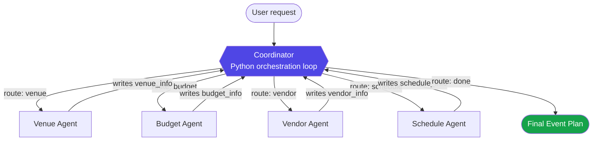
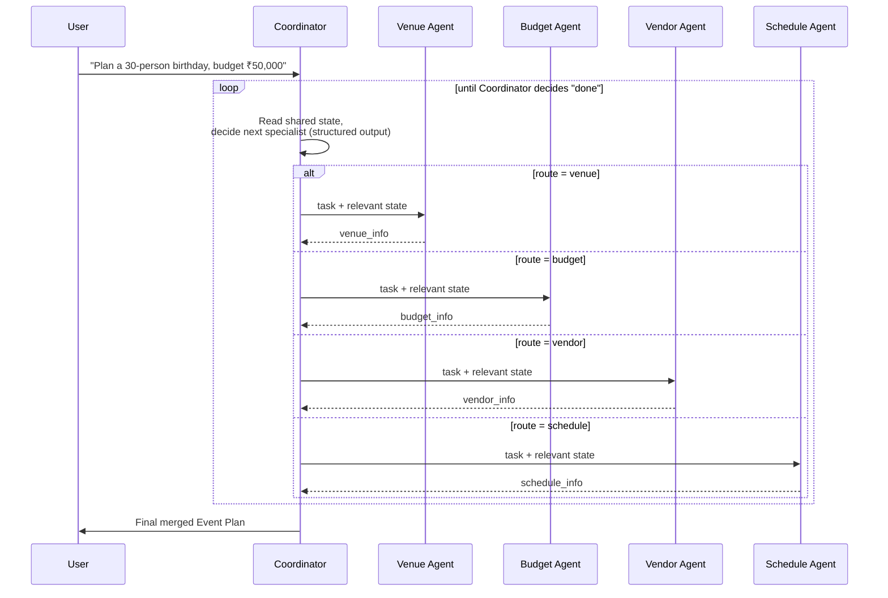

# Smart Event Planning Assistant

A multi-agent event-planning system built with **LangChain**, using a
**supervisor architecture** where a Coordinator agent routes work to four specialist
agents and merges their output into one final event plan, presented through a
**Streamlit** web UI.

This is a learning project (from `Crew-AI/Assignment.md`, Assignment 1) — deliberately
built with **LangChain**, not CrewAI, and **not LangGraph either** (not covered yet),
built **one file at a time** so every LangChain concept is understood before moving to
the next.

> Companion file: [`learning.md`](./learning.md) — a running log of every concept
> covered, file by file, as we build.

---

## 1. Problem Statement

> Build a Multi-Agent System that helps users plan events such as birthdays, corporate
> gatherings, workshops, weddings, or celebrations based on budget, preferences, and
> attendee count. The system should coordinate multiple agents to generate a complete
> event plan.

## 2. Agents

| Agent | Responsibility | Can Route Others? |
|---|---|---|
| **Coordinator** (supervisor) | Understands the request, decides which specialist runs next, detects when the plan is complete, merges everything into the final report | ✅ Yes |
| **Venue Agent** | Finds suitable venues for the budget, event type, and attendee count | ❌ No |
| **Budget Agent** | Builds a cost breakdown, expense categories, and optimization suggestions | ❌ No |
| **Vendor Agent** | Recommends catering, decoration, photography, entertainment | ❌ No |
| **Schedule Agent** | Builds the event timeline / activity schedule, including setup & closing | ❌ No |

This mirrors `Hospital-AI`'s receptionist → specialists pattern, but instead of
CrewAI's `Process.hierarchical`, the routing loop is made **explicit and visible** as a
plain Python orchestration loop — which is the point of building this in LangChain:
you see every hop instead of trusting a framework's internal delegation.

---

## 3. Why this is pure LangChain (no LangGraph)

This project is deliberately built **without LangGraph** — you haven't reached that
topic yet, and multi-agent orchestration is a real, well-established pattern in plain
LangChain too. Nothing below needs a graph engine:

- **A shared state object** — a plain Python `dataclass`, `EventState`, passed around
  by hand. Every specialist reads what it needs from it and writes back its own field.
  This replaces the "concatenate everything into one string" approach from
  `multi-agent-demo/`'s scripts with a proper typed object — still just Python, no
  new framework.
- **A hand-written orchestration loop** — the same shape as
  `multi-agent-demo/workflows/supervisor_flow.py`, but upgraded in two ways:
  1. Each specialist is a real LangChain tool-using agent, built with
     **`create_agent`** (LangChain 1.x's current agent constructor — the older
     `create_react_agent` + `AgentExecutor` combo from `Langchain/Langchainnew.py`
     was moved into a separate legacy package as of LangChain 1.0) with its own
     tools — not a single raw prompt call.
  2. The Coordinator's routing decision comes from LangChain's **structured output**
     (`with_structured_output` + a Pydantic model), which forces the LLM to return
     `{"next": "venue" | "budget" | "vendor" | "schedule" | "done", "reason": "..."}`
     — replacing the fragile `"travel" in decision.lower()` string-matching from
     `multi-agent-demo/workflows/supervisor_flow.py` with something that can't
     mis-parse.

So: **agents** = LangChain (`create_react_agent`/`AgentExecutor`), **tools** =
LangChain (`@tool`), **routing** = LangChain (`with_structured_output`),
**orchestration loop** = plain Python you write and can see line-by-line. LangGraph,
when you get to it later, is really just "the same loop, but the framework runs it
for you and gives you visualization/checkpointing for free" — this project is the
solid foundation that upgrade will sit on top of.

---

## 4. Architecture



Every specialist only ever talks to the Coordinator — never to each other directly
(a **star topology**, the simplest and most debuggable multi-agent shape). The
Coordinator is the *only* node that decides what happens next, and it decides by
looking at the shared `State`: which fields are still empty, and what the user
actually asked for (e.g. a request with no mention of catering might skip the Vendor
Agent entirely).

## 5. The Supervisor Loop, Step by Step



## 6. Shared State (plain Python, no framework)

```python
from dataclasses import dataclass, field

@dataclass
class EventState:
    user_request: str                    # original ask, never overwritten
    history: list[str] = field(default_factory=list)   # trace of what ran, for debugging
    venue_info: str | None = None
    budget_info: str | None = None
    vendor_info: str | None = None
    schedule_info: str | None = None
    final_report: str | None = None
```

Every specialist's *only* job is: read what it needs from `EventState`, do its work
(optionally calling a tool), and write back into its own field. It never touches any
other agent's field — that discipline is what makes "add a 5th agent later" (one of
the assignment's clues) a safe, additive change, and it's what makes the Coordinator's
job simple: look at which fields are still `None` plus the original request, decide
what's next.

---

## 7. Tools per Agent

| Agent | Tool(s) | What it does |
|---|---|---|
| Venue Agent | `search_venues` | Web search (Serper API) for venues matching event type + city + budget |
| Budget Agent | `calculate_budget` | Deterministic cost breakdown & totals (no LLM math — same lesson as `Shoppingagent`'s `compare_prices`: let code do arithmetic, not the LLM) |
| Vendor Agent | `search_vendors` | Web search (Serper API) for catering/decoration/photography/entertainment |
| Schedule Agent | *(none required)* | Pure reasoning over `venue_info` + attendee count to build a timeline; a `build_timeline` helper tool is optional/stretch |

If `SERPER_API_KEY` is not set, the search tools fall back to a clearly-labeled mock
result so the whole graph still runs end-to-end offline while you're learning.

---

## 8. Model

Google **Gemini**, via `langchain-google-genai` (LangChain's official Gemini
integration — the direct equivalent of `ChatOllama` you've already used, just a
different provider, which is exactly LangChain's **Model Abstraction** feature in
practice).

```python
from langchain_google_genai import ChatGoogleGenerativeAI

llm = ChatGoogleGenerativeAI(model=os.getenv("GEMINI_MODEL", "gemini-3.6-flash"), temperature=0)
```

Two instances, same pattern `Hospital-AI/agents.py` used: `temperature=0` for the
Coordinator (routing should be deterministic), `temperature=0.3` for specialists
(a little more natural language for recommendations).

---

## 9. Concepts Covered (cross-referenced to `Langchain/langchain.md`)

| File | LangChain Concepts |
|---|---|
| `state.py` | State Management (as a plain dataclass — the concept, without LangGraph's machinery) |
| `tools.py` | Tool Framework (`@tool`, docstring-as-description, structured input) |
| `agents.py` | Model Abstraction (Gemini via `langchain-google-genai`), `create_agent` (LangChain 1.x), Multistep Reasoning (tool-calling loop) |
| `supervisor.py` | Structured Output (Pydantic + `with_structured_output`), the Supervisor multi-agent pattern |
| `orchestrator.py` | Workflow Orchestration written by hand (Sequential + Conditional/Branching, same primitives as `multi-agent-demo/`, applied properly) |
| `app.py` | Streamlit web UI wrapping the orchestration loop — takes the event brief as form input, runs the Coordinator loop, renders the final report (not a LangChain concept itself; it's the delivery layer on top of everything else) |

---

## 10. Project Structure (target)

```
Event-Planner-AI/
├── .env                 # GEMINI_API_KEY, SERPER_API_KEY (you fill in)
├── .gitignore
├── requirements.txt
├── README.md            # this file
├── learning.md          # concept log, updated after each .py file
├── state.py             # 1. shared state (plain dataclass)
├── tools.py             # 2. domain tools
├── agents.py            # 3. the 4 specialist agents (LangChain ReAct agents)
├── supervisor.py        # 4. coordinator / router (structured output)
├── orchestrator.py      # 5. the hand-written orchestration loop
└── app.py               # 6. Streamlit web UI entry point
```

## 11. Setup

1. Create a virtual environment and install dependencies (`requirements.txt` is filled
   in as we add each file, matching what's actually imported — `streamlit` gets added
   when we build `app.py`):
   ```bash
   python -m venv venv
   venv\Scripts\activate
   pip install -r requirements.txt
   ```
2. Fill in `.env`:
   ```
   GEMINI_API_KEY=your_key_here
   SERPER_API_KEY=your_key_here
   ```
3. Run once everything is built:
   ```bash
   streamlit run app.py
   ```

## 12. Expected Output

A **Streamlit web page** where the user fills in event details (type, budget,
attendee count, city, preferences) and, after the Coordinator loop finishes, sees a
final **Event Plan** rendered on the page containing:
- Venue Recommendation
- Budget Summary
- Vendor Suggestions
- Event Schedule
- Final Recommendations

## 13. Status

🚧 In progress — built incrementally, one file at a time, as a LangChain learning
exercise. See `learning.md` for what's been covered so far.
